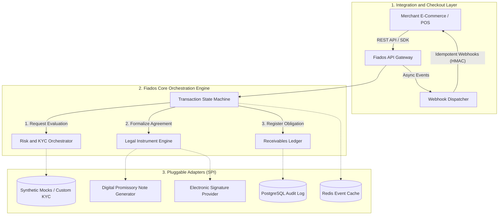

# Fiados

[](https://opensource.org/licenses/MIT)
[](https://www.python.org/downloads/)
[](https://github.com/astral-sh/ruff)
[](#system-architecture)
[](https://branddb.wipo.int/en/brand/BR500000942577175)

> **Fiados** is an open-source, universal deferred-payment orchestration engine and software development kit (SDK) designed to facilitate transparent, non-predatory "Buy Now, Pay Later" (BNPL) credit arrangements for any transaction type—including retail, services, ticketing, and B2B invoicing.

---

## 🌟 Overview

The practice of informal deferred payment (*"vender fiado"*) has historically powered local commerce on mutual trust. However, modern digital commerce forces merchants into either expensive bank credit rails or proprietary closed-ecosystem BNPL fintechs that impose steep commissions and isolate customer relationships.

**Fiados** revitalizes deferred settlement as an open, self-hosted infrastructure. By formalizing future payment obligations through **digitally signed promissory notes** backed by international legal conventions, Fiados empowers merchants and platform operators to underwrite, issue, and orchestrate receivables on their own terms.

### Key Highlights
- **Universal & Vertical-Agnostic:** Built from the ground up to orchestrate transactions across e-commerce, professional services, seasonal tourism, and recurring B2B invoices.
- **Legally Enforceable Credit Instruments:** Automatically synthesizes digital promissory notes conforming to the **Geneva Convention Providing a Uniform Law for Bills of Exchange and Promissory Notes** ([League of Nations Treaty Series #560](https://treaties.un.org/pages/LONViewDetails.aspx?src=LON&id=560&chapter=30&clang=_en)), complete with cryptographic audit trails and electronic signature integrations.
- **Zero-PII & Synthetic-First Design:** Strict architectural separation between core domain logic and data providers, accompanied by deterministic mock generators to ensure no personal consumer data is ever required in development or testing environments.
- **Permissive Open-Source Core:** Released under the **MIT License**, designed for complete self-hosting, extensible adaptation, and long-term ecosystem compatibility.

---

## 🏗️ System Architecture

Fiados employs a clean, modular event-driven architecture that separates merchant integration, risk evaluation, legal document compilation, and ledger lifecycle operations.



---

## ✨ Features

- **Deterministic Transaction State Machine:**  
  A strict finite-state machine (FSM) enforcing idempotent lifecycle transitions:  
  `DRAFT` $\rightarrow$ `EVALUATING` $\rightarrow$ `FORMALIZED` $\rightarrow$ `ACTIVE` $\rightarrow$ `SETTLED / DEFAULTED`

- **Digital Promissory Note Generation:**  
  Programmatic compilation of formal credit titles with embedded SHA-256 checksums, issuer/debtor credentials, clear amortization tables, and immutable evidence logs.

- **Pluggable Risk & Decisioning Pipeline:**  
  Configurable multi-layered decision pipelines allowing operators to define custom eligibility rules, debt-to-income checks, and risk limits—or integrate external fraud/KYC services via clean adapter interfaces.

- **Asynchronous Webhook Bus:**  
  Reliable event dispatching with exponential backoff, dead-letter queues (DLQ), and HMAC-SHA256 signature verification for seamless merchant order updates.

- **Developer Sandbox & Synthetic Fixtures:**  
  Ships with built-in factories producing realistic test personas, dummy identification documents, and simulated credit responses without touching real third-party data.

---

## 🚀 Getting Started

### Prerequisites
- **Python:** 3.11 or higher
- **Package Manager:** [`uv`](https://github.com/astral-sh/uv) (recommended) or `poetry` / `pip`
- **Container Runtime:** Docker and Docker Compose (optional for database & caching)

### Local Development Setup

1. **Clone the repository:**
   ```bash
   git clone https://github.com/olh/Fiados.git
   cd Fiados
   ```

2. **Create and activate a virtual environment:**
   ```bash
   # Using uv
   uv venv
   source .venv/bin/activate  # On Windows: .venv\Scripts\activate

   # Install dependencies with development and testing tools
   uv pip install -e ".[dev,test]"
   ```

3. **Configure Environment Variables:**
   ```bash
   cp .env.example .env
   ```

4. **Launch Local Services (PostgreSQL + Redis):**
   ```bash
   docker compose up -d
   ```

5. **Run Database Migrations:**
   ```bash
   python -m fiados.manage migrate
   ```

6. **Start the Development Server:**
   ```bash
   uvicorn fiados.api.main:app --reload --host 0.0.0.0 --port 8000
   ```
   Explore the interactive OpenAPI documentation at `http://localhost:8000/docs`.

---

## 🧪 Testing & Code Quality

Fiados enforces high standards of code reliability, static typing, and test coverage:

```bash
# Run unit, integration, and state-machine property tests
pytest --cov=fiados tests/

# Format and lint codebase
ruff check .
ruff format .

# Type checking
mypy fiados/
```

All test suites strictly utilize **synthetic mock fixtures**, ensuring 100% compliance with data privacy standards and offline capability.

---

## 🗺️ Project Roadmap

| Phase | Milestone | Focus Areas | Status |
| :--- | :--- | :--- | :--- |
| **Sprint 1** | **Core Domain & State Machine** | Pydantic v2 schemas, PostgreSQL ledger tables, deterministic FSM state transitions, synthetic test harness. | 🟡 In Progress |
| **Sprint 2** | **Legal Instrument Generator** | Automated PDF/A synthesis for promissory notes, SHA-256 integrity chaining, e-signature adapter SPI. | ⚪ Planned |
| **Sprint 3** | **Risk & Policy Middleware** | Rule-chain execution engine, velocity checks, mock scoring endpoints, merchant policy configuration. | ⚪ Planned |
| **Sprint 4** | **Integration Bus & Webhooks** | Outbound webhook dispatcher, HMAC signing, exponential retry worker queues, checkout client SDKs. | ⚪ Planned |
| **Sprint 5** | **Developer Tooling & Packaging** | `fiados-cli` sandbox simulator, comprehensive OpenAPI docs, end-to-end integration benchmark suite. | ⚪ Planned |

---

## 📜 Legal Framework & Intellectual Property

- **Geneva Convention Compliance:** The digital promissory notes generated by Fiados are structured around the internationally recognized standards established by the *Convention Providing a Uniform Law for Bills of Exchange and Promissory Notes* ([Geneva, 1930 / League of Nations](https://treaties.un.org/pages/LONViewDetails.aspx?src=LON&id=560&chapter=30&clang=_en)).
- **Project Genesis & Clean-Room Development:** The economic assumptions, legal feasibility, and operational workflows behind Fiados were initially explored and validated during Cycle I of the *Mais Turismo* Program ([Itaipu Parquetec / Brazilian Ministry of Tourism](https://campanha.itaipuparquetec.org.br/mais-turismo/)) as a private project with zero program IP encumbrances. This open-source repository is an entirely independent, clean-room implementation engineered from scratch.
- **Trademark:** The trademark "Fiados" has a priority filing registered in Brazil with priority date January 30, 2026 ([WIPO Global Brand Database Record #BR500000942577175](https://branddb.wipo.int/en/brand/BR500000942577175)).

---

## 🤝 Contributing

Contributions are warmly welcomed! Please review our [Contributing Guidelines](CONTRIBUTING.md) and [Code of Conduct](CODE_OF_CONDUCT.md) before submitting pull requests.

To maintain privacy and security, pull requests containing production keys, credentials, or non-synthetic personal data will be rejected automatically.

---

## 📄 License

Fiados is open-source software licensed under the **[MIT License](LICENSE)**.
